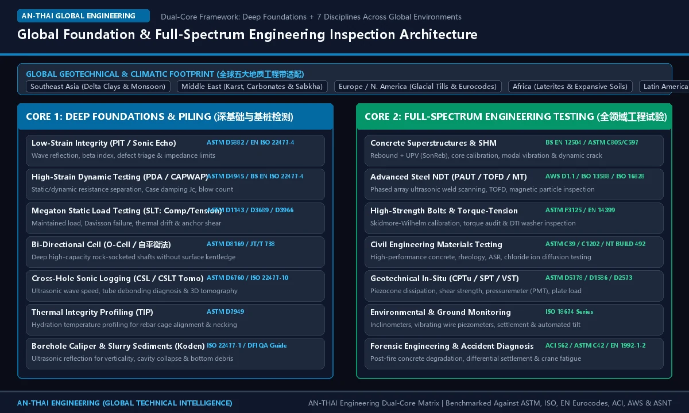
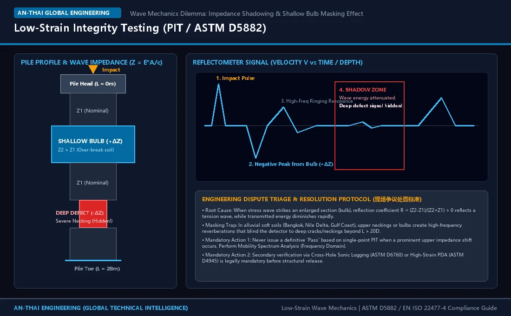
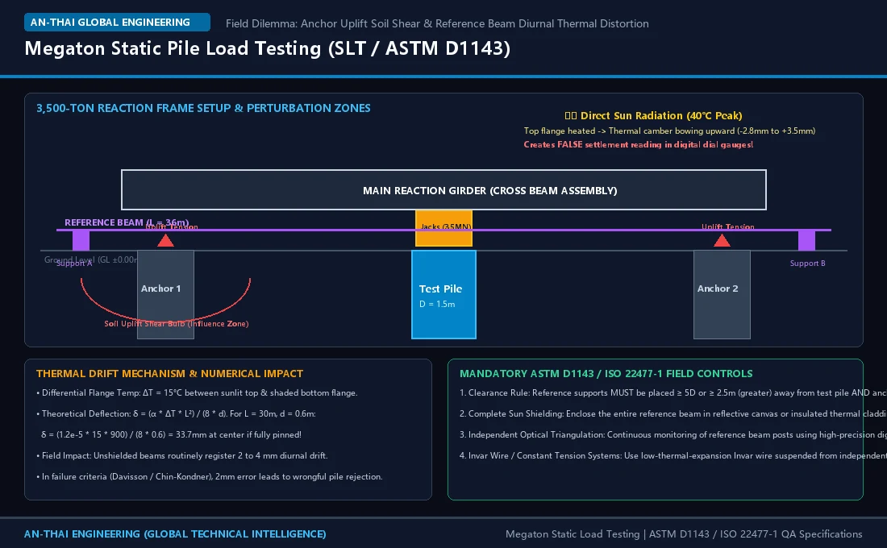
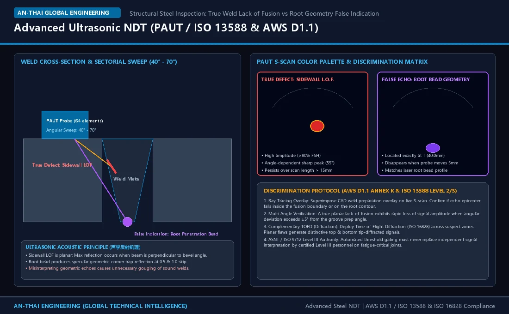
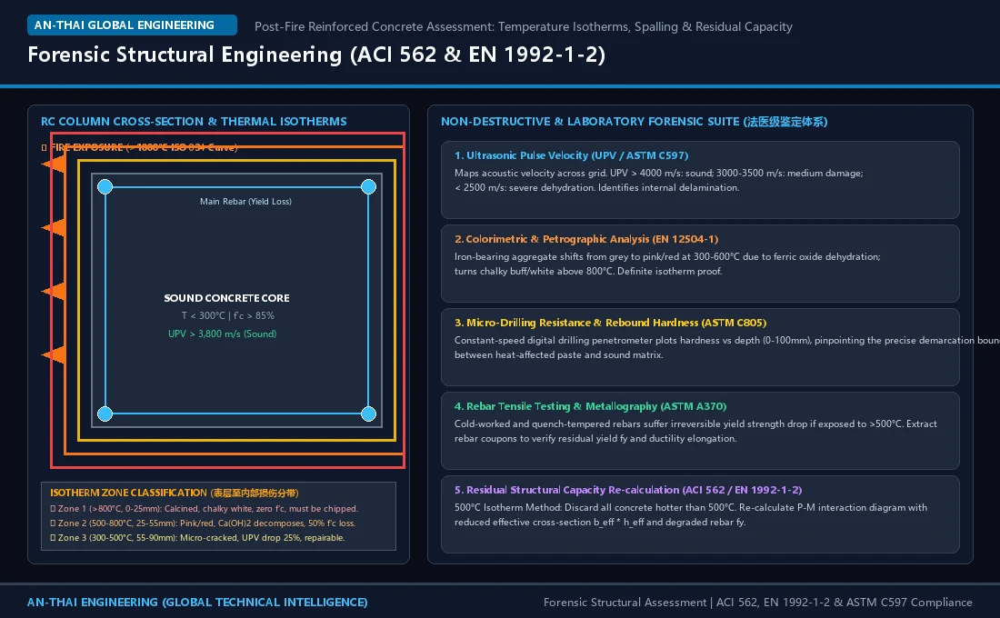
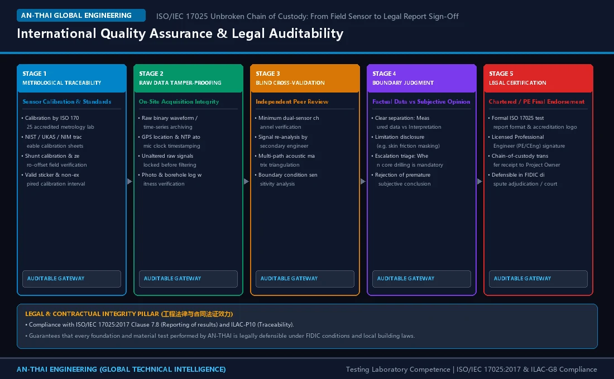

# An-Thai 全球桩基工程与全领域工程检测实战洞察（中文实战指南）
## 全球深基础与全品类工程检测评估：实战技术手册与工程法医质量控制

> **文档编号：** ANTHAI-ENG-MANUAL-20261118-01-ZH  
> **文档性质：** 现场技术规程 / B2B 深度技术洞察报告  
> **编制与技术主体：** AN-THAI Engineering Company Limited（安泰工程技术质检与工程法医中心）  
> **全球工程地质覆盖域：** 东南亚冲积三角洲软土、中东海相碳酸盐岩/溶洞/盐渍土、欧美冰川沉积/超固结硬粘土、非洲红粘土/膨胀黑棉土、拉美高烈度地震带与火山灰沉积  
> **实验室与质量体系对标：** ISO/IEC 17025:2017 检测与校准实验室能力通用要求 | ILAC-G8 合格判定规则  
> **发布状态：** 评审候选稿（分支：`t3/global-engineering-insights`，提交 PR 待审）

---

## 宏观定位与全球化专业视野 (Executive Strategic Architecture)

面对跨国重大基础设施（包括深水港口、跨海与跨河桥梁、重载铁路、超高层核心筒、LNG 接收站储罐基础及重工业石化基地），传统的工程检测往往受限于地域条块分割与单项试验的狭隘视角，极易在遇到地质异常或施工缺陷时产生误判与索赔纠纷。

**AN-THAI Engineering（安泰工程）** 彻底打破地域与单一业务局限，构建面向全球工程环境的**“双核驱动”实战架构**：
1. **核心一：桩基与深基础工程极限承载力与完整性诊断**——从成孔垂直度与孔底沉渣超声扫描，到低应变、高应变、声波透射、热敏完整性，直至数千吨级大吨位静载荷与双向自平衡（O-Cell）试验。
2. **核心二：工程领域全品类试验检测与法医事故鉴定纵贯体系**——纵向贯通主体结构无损检测、钢结构工业相控阵超声（PAUT/TOFD）、土木材料室内外物理化学力学试验、岩土原位勘察触探、环境及施工自动化监测、以及既有工程质量事故法医鉴定。


*图 1：AN-THAI 全球双核架构：覆盖 7 大工程试验检测品类与全球五大地质工程带，对标 ASTM、ISO、EN Eurocode、ACI、AWS 等国际权威标准体系。*

---

## 一、全球五大地质工程带与技术对标适配 (Global Geological Alignment)

工程检测从来不是孤立的力学读数，必须与地层土-结构相互作用紧密结合。不同区域地质条件决定了试验方法的物理边界与假象甄别：

| 全球地质工程带 | 主要地层与工程地质特征 | 施工核心风险与检测陷阱 | 核心对标国际检测规程 |
| :--- | :--- | :--- | :--- |
| **东南亚冲积三角洲 (Southeast Asia)** | 湄南河/湄公河厚层极软海相粘土（$S_u < 20\text{ kPa}$）、高承压地下水位、深部密实砂层 | 桩身负摩阻力、浅部缩颈与扩颈交替、水化热温差引发声测管脱粘假缺陷、桩基侧向过大挠度 | ASTM D6760 (CSL), ASTM D5882 (PIT), ASTM D1143 (SLT), CPTu 超孔压消散 |
| **中东碳酸盐岩与盐渍土 (Middle East)** | 珊瑚礁灰岩、地下溶洞与裂隙网、石膏质砂层、强腐蚀性萨布哈（Sabkha）高盐地下水（$\text{Cl}^- > 30,000\text{ mg/L}$） | 钻孔泥浆漏失与孔壁坍塌、高硫酸盐/氯盐侵蚀导致混凝土劣化、桩端嵌岩承载力离散度极大 | Koden 超声成孔孔径检测、O-Cell 双向自平衡（ASTM D8169）、ASTM C1202 电通量、TIP 热敏完整性 |
| **欧美冰川沉积与超固结硬土 (Europe & North America)** | 超固结伦敦粘土、冰碛漂砾土、极密密实冰水堆积层、硬质基岩嵌岩桩 | 高应变动测桩端土动阻尼过高导致静承载力低估、超大吨位静载试验锚桩受拉拔脱锚剪切失稳 | BS EN ISO 22477 系列、BS EN 12504、ASTM D4945 (PDA/CAPWAP)、TOFD 焊缝检测 |
| **非洲红粘土与膨胀土 (Africa)** | 富铁铝质红粘土（红土化土）、浸水湿陷性砂土、膨胀性黑棉土（蒙脱石为主） | 季节性干湿交替引起桩身反向拉力、浅层土浸水湿陷诱发建筑物不均匀沉降、红粘土结构裂隙脆性破坏 | 平板载荷试验（ASTM D1194）、原位十字板（ASTM D2573）、全自动测斜仪与渗压计阵列（ISO 18674） |
| **拉美板块地震带与火山沉积 (Latin America)** | 高压缩性火山灰沉积土（Andosols）、高烈度俯冲带冲积砾卵石层 | 地震液化诱发桩周摩阻力丧失、桩土 $p-y$ 曲线循环弱化、既有结构震后残余刚度损伤 | 循环水平推力试验（ASTM D3966）、井下跨孔地震波波速测试、结构健康监测（SHM）模态振动测试 |

---

## 二、全品类工程检测与试验覆盖域（7 大专业板块实战体系）

### 2.1 板块一：基桩与地下基础工程检测 (Deep Foundations & Piling)
- **低应变反射波法完整性检测 (PIT / Sonic Echo / Impulse Response)**：对标 **ASTM D5882** 与 **EN ISO 22477-4**。判定桩身混凝土结构完整性，探测桩身断桩、夹泥、严重缩颈、离析及空洞位置，标定有效波速与阻抗变化指数（$\beta$ 值）。
- **高应变动态载荷试验 (PDA / CAPWAP)**：对标 **ASTM D4945**。采用大吨位重锤（锤重通常为目标极限承载力的 $1.5\%\sim 2.5\%$）冲击桩顶，利用安装在桩侧对称位置的应变传感器与压阻式加速度计同步采集力和速度时程曲线，经 CAPWAP 波动方程迭代分离静阻力与土动阻尼，获取单桩极限承载力及沿程侧阻力分布。
- **基桩静载荷试验 (SLT: 轴向抗压、抗拔、水平推力)**：对标 **ASTM D1143 / D1143M**（抗压）、**ASTM D3689**（抗拔）、**ASTM D3966**（水平）。作为全球公认的承载力裁决性终审标准，采用慢速维持荷载法（Maintained Load Method）严格测定荷载-沉降（$Q-s$）全曲线。
- **深水超大吨位双向自平衡载荷试验 (O-Cell / 自平衡法)**：对标 **ASTM D8169 / D8169M** 与 **JT/T 738**。将特制液压荷载箱精确预埋于桩身平衡点处，上下段桩身互为反力，摆脱地面数千吨配重堆载或群锚反应梁的作业风险，特别适用于江河跨海特大桥超深嵌岩桩。
- **声波透射法超声波完整性检测 (CSL / CSLT 三维层析成像)**：对标 **ASTM D6760**。利用预埋声测管充水耦合，高频探头（40–60 kHz）以等步距逐点发射接收超声波，获取声时（FAT）、波幅声能、主频衰减曲线；结合层析算法构建桩身三维声速断层切片。
- **热敏完整性测试 (TIP, Thermal Integrity Profiling)**：对标 **ASTM D7949**。在混凝土浇筑后 12–48 小时水化热高峰期，通过全长预埋热敏电阻线缆或探棒测量桩身内部温度场，反演钢筋笼居中度、有效保护层厚度及局部缩径鼓包。
- **钻孔成孔质量与孔底沉渣超声扫描 (Koden / Sonic Caliper)**：浇筑前使用高灵敏度超声波孔壁回波仪，测定全孔深度内孔径收缩、坍孔空洞、成孔垂直度偏差（倾斜率）及孔底沉渣厚度。

### 2.2 板块二：主体结构与建构筑物检测 (Superstructures & Buildings)
- **混凝土结构现场无损及半破损综合评定**：采用**超声回弹综合法 (SonReb Method, ASTM C597 + ASTM C805 / BS EN 12504-2)**，以声速与回弹值双参数消除水分与碳化影响，并钻取小直径芯样（**ASTM C42 / BS EN 12504-1**）建立工程专用乘积修正曲线。
- **钢筋配置与保护层厚度高频电磁/雷达扫描**：遵循 **BS 1881-204**，利用多通道电磁感应仪与三维透地雷达（GPR）精确反演梁柱板内部主筋直径、箍筋间距及净保护层厚度。
- **碳化深度与钢筋脱钝活化测试**：利用 $1\%$ 酚酞酒精溶液于新折断构件孔洞内显色喷涂（**BS EN 14630**），精确至 $0.5\text{ mm}$ 测量碳化深度，评估氯离子与二氧化碳协同侵蚀风险。
- **楼板、构件及桥跨结构静动载变形试验**：利用精密切割水袋或液压反力架对结构施加设计荷载，架设光纤光栅应变计与数字 LVDT 位移传感器，评定最大实测挠度与残余变形是否满足规范限值（**ACI 318 / EN 1992**）。
- **结构健康监测 (SHM) 与环境振动操作模态分析 (OMA)**：布设超低频高灵敏度加速度传感器阵列，采集脉动微振信号，识别桥梁或超高层主体的前几阶固有频率、阻尼比与振型矩阵，追踪刚度退化趋势。

### 2.3 板块三：钢结构与特种设备工业无损检测 (Steel Structures & Industrial NDT)
- **相控阵超声波探伤 (PAUT)**：对标 **ISO 13588** 与 **AWS D1.1 Annex K**。采用 64 或 128 阵元换能器在楔块上实现 $40^\circ\sim 70^\circ$ 扇形扫查（$S\text{-scan}$），对重型特厚板全熔透焊缝进行三维体积式快速探伤，精确记录回波位置与深度。
- **衍射时差法超声检测 (TOFD)**：对标 **ISO 16828**。利用焊缝两侧双探头发射接收尖端衍射微弱波，以衍射时间差高精度测定缺陷自身高度及上下端点深度，不受波幅反射各向异性影响。
- **常规表面与体积无损探伤**：磁粉探伤（MT，**ASTM E709 / ISO 9934**）、液体渗透探伤（PT，**ASTM E165 / ISO 3452**）、工业射线检测（RT，**ISO 17636**）及电涡流探伤（ET，**ISO 15549**）。
- **高强度螺栓连接副施工质量监控**：扭剪型与大六角头高强螺栓终拧扭矩现场抽测（**ASTM F3125 / EN 14399**），采用 Skidmore-Wilhelm 轴力校准仪标定扭矩系数，测定直接拉力指示垫圈（DTI）塞尺间隙。
- **工业防腐涂层质量评估**：采用电磁感应法测量干膜厚度（DFT，**SSPC-PA 2 / ISO 2808**），以及液压微型拉拔仪测定重防腐涂层与钢材基底的附着力破坏强度（**ASTM D4541 / ISO 4624**）。

### 2.4 板块四：土木工程材料室内与现场试验 (Civil Engineering Materials)
- **水泥与活性矿物掺合料物化力学测试**：标准稠度用水量、凝结时间（**ASTM C191**）、勃氏比表面积细度（**ASTM C204**）、胶砂抗压抗折强度（**ASTM C109 / EN 196-1**）。
- **骨料工程性能与物理级配**：筛分颗粒级配曲线、针片状颗粒含量（**BS EN 933-3**）、洛杉矶磨耗损失率（**ASTM C131**）及骨料压碎值（ACV，**BS 812-110**）。
- **新拌混凝土流变与施工工作性**：坍落度与坍落扩展度（**ASTM C143**）、自密实混凝土（SCC）V型漏斗通过时间与L型箱障碍流动比（**ASTM C1611 / C1621**）、压力法含气量（**ASTM C231**）及泌水率测试。
- **硬化混凝土耐久性与微观传输特性**：氯离子电通量测试（RCPT，**ASTM C1202**）、非稳态氯离子快速迁移系数测试（RCM，**NT BUILD 492**）、抗渗水压力试验（**DIN 1048-5**）、快速冻融循环质量损失与动弹性模量测试（**ASTM C666**）。
- **工程钢筋力学及焊接接头试验**：热轧带肋钢筋拉伸屈服强度、极限强度、断后伸长率与 $180^\circ$ 冷弯试验（**ASTM A370 / ISO 15630-1**）；机械连接套筒单向拉伸残余变形与高应力反复拉压疲劳试验（**ISO 15835**）。

### 2.5 板块五：岩土工程勘察与现场原位测试 (Geotechnical In-Situ Field Testing)
- **孔压静力触探 (CPTu)**：对标 **ASTM D5778** 与 **ISO 22476-1**。数字化高灵敏度锥头连续记录锥尖阻力 $q_c$、侧壁摩阻力 $f_s$ 及动孔隙水压力 $u_2$；并在目标软土层开展孔压消散试验（$t_{50}$），原位反演水平固结系数 $c_h$ 与渗透系数 $k_h$。
- **标准贯入试验 (SPT)**：对标 **ASTM D1586**。现场安装动力仪器化贯入杆，实测穿心锤能量传递效率（ETR），对实测击数 $N$ 严格修正为归一化能量击数 $N_{60}$。
- **现场十字板剪切试验 (VST)**：对标 **ASTM D2573**。在极软弱原状粘土层中直接扭转十字金属板，测定原位不排水峰值抗剪强度 $S_u$ 及重塑剪切强度 $S_{ur}$，计算灵敏度 $S_t$。
- **旁压试验 (PMT)**：对标 **ASTM D4719 / ISO 22476-4**。在钻孔指定深度对弹性圆柱膜施加径向增量水压，绘制体积-压力膨胀曲线，测定梅纳德旁压模量 $E_M$、蠕变压力 $p_f$ 及极限侧向压力 $p_L$。
- **浅基础平板载荷试验 (PLT)**：对标 **ASTM D1194 / BS 1377-9**。采用钢质刚性承压板于地基土表面施加阶梯荷载，测算地基基床系数（反力模量 $k_s$）及天然地基容许承载力。

### 2.6 板块六：工程施工与环境岩土监测 (Geotechnical & Environmental Monitoring)
- **基坑支护与边坡深层水平位移监测 (测斜仪)**：遵循 **ISO 18674-3**，在地下连续墙、排桩或滑坡体预埋导向凹槽测斜管，采用双轴伺服加速度计测斜探头正反两次测读（$A+/A-$），积分求解深层水平位移包络曲线。
- **地下水承压水头与孔隙水压力动态监测**：遵循 **ISO 18674-4**，采用钻孔膨润土微膨胀密封工艺，布设高阻水振弦式渗压计（VWP），自动化采集抽水降水期间的水头骤降与回弹时程。
- **周边地表与建构筑物沉降观测**：采用一级光学电子水准仪与铟钢尺，以场外深埋基岩基准标石为基准，布设闭合几何水准监测环网，闭合差控制在 $\pm 0.3\sqrt{n}\text{ mm}$ 以内。
- **预应力锚索与支撑轴力监测**：安装中空穿心式振弦荷载盒，实时监测深基坑开挖期间锚索应力松弛或超载预警。

### 2.7 板块七：工程质量事故诊断、病害检测与法医鉴定 (Forensic Structural Engineering)
- **建筑物不均匀沉降与倾斜事故鉴定**：结合沉降时间曲线、各角点沉降差、空间倾斜率向量以及主体砌体/混凝土裂缝开展反向运动学倒查，厘清地质未详、邻近深基坑抽水、违规超载等事故诱因。
- **火灾后钢筋混凝土构件损伤评估与加固验算**：依据 **ACI 562** 与 **EN 1992-1-2**，测定受火温升等温线深度，检测水泥胶体脱水酥松深度与钢筋高温退火强度损失，重新验算构件轴压比与抗弯刚度。
- **混凝土碱骨料反应 (ASR) 与延迟钙矾石 (DEF) 膨胀破损**：采用偏光显微镜岩相切片（**ASTM C856**）、醋酸铀荧光显色及残余膨胀试验（**ASTM C1260**），鉴别网状龟裂与胶体析出机理。
- **重型厂房吊车梁疲劳微裂纹与震后安全性鉴定**：采用高灵敏度磁粉探伤与相控阵超声波，确定下翼缘与腹板焊缝处的疲劳微裂纹尺寸，依据断裂力学（**BS 7608**）评估结构剩余疲劳寿命与失稳风险。

---

## 三、现场技术痛点、争议与疑难杂症实战深挖 (Real Field Dilemmas & Resolution)

### 3.1 痛点一：低应变反射波法（PIT）浅部扩颈对深部严重缺陷的遮蔽与盲区
**工程争议现场：**  
在现场检测中，当灌注桩在浅部（如 $2\sim 5\text{ m}$ 处）因套管拔出不当或土层局部坍塌形成大体积扩颈时，其波阻抗急剧增加：
$$Z_2 = \frac{E \cdot A_2}{c} > Z_1$$
锤击入射压缩波行进至该变截面处，反射系数：
$$R = \frac{Z_2 - Z_1}{Z_2 + Z_1} > 0$$
产生向下反射的拉伸应力波（速度时程曲线上表现为强烈的反向负向谷值）。此时绝大部分应力波能量在变截面处发生反复振荡反射（波陷阱效应），透过扩颈继续向下传播的透射波能量极度衰减。  
若在桩身更深处（如 $18\text{ m}$ 处）存在严重缩颈或断桩泥夹层，其微弱的二次反射波完全淹没在浅部扩颈引起的浅表瑞利波和高频多重共振杂波中。许多缺乏深厚理论功底的检测人员出具“桩身完好、仅浅部微扩”的错误报告，埋下建筑沉降倾斜的致命隐患！


*图 2：低应变反射波法应力波传播机理：浅部扩颈（+ΔZ）导致入射波能量大幅消耗与高频共振，在深部形成完全遮蔽区，掩盖深层严重缩颈缺陷。*

**AN-THAI 工程判定裁决路径：**
1. **频域导纳曲线校验（Mobility Spectrum Analysis）**：禁止单一依赖时域速度滤波信号。转换分析力与速度频域机械导纳曲线（$N = v/F$）。若浅部存在突变，低频导纳值 $N_0 = \frac{1}{\rho c A}$ 会发生严重偏移且高频共振峰密集，若无深部桩端周期性共振峰，表明波已无法到达深层，该时域信号在深部属于**“无检测能力盲区”**。
2. **长径比几何硬约束（$L/D$ 规则）**：严格执行 **ASTM D5882 §6.3.2**，在复杂地层中，长径比 $L/D > 20$ 且上部有明显阻抗突变时，PIT 报告结论必须注明“深部无有效检测波，不具桩底判定效力”。
3. **强制无损升级复核**：凡遇阻抗反射系数 $|R| > 0.20$ 且桩基承载力等级为一级者，合同条款强制启动**声波透射法（ASTM D6760）**或**高应变动测（ASTM D4945）**二次复核，严防盲区漏检。

---

### 3.2 痛点二：3500吨+ 超大吨位静载试验锚桩受拉拔脱锚与基准梁日照热位移失真
**工程争议现场：**  
在大型桩基轴向抗压静载荷试验（加载至 $35\text{ MN}\sim 40\text{ MN}$）中，采用多根抗拔锚桩作为反力支撑。现场常出现两大假象：
1. **锚桩向上拉拔剪切土体影响区**：当加载至高荷载级时，锚桩受拉向上隆起，其周围地层发生向上剪切变形。若基准梁的支承架距离锚桩过近（小于 4 倍桩径），基准桩将随地表一起向上隆起，导致百分表/LVDT 实测的试桩沉降值**虚假偏大**；反之，若基准梁支架处于沉降漏斗区，沉降读数则会**虚假偏小**。
2. **超长钢基准梁日照温差“假沉降”**：现场采用跨度 $24\text{ m}\sim 36\text{ m}$ 的工字钢基准梁。烈日直射下，基准梁上翼缘温度可达 $45^\circ\text{C}$，而背阴下翼缘仅 $28^\circ\text{C}$。根据双金属热弯曲力学公式：
$$\delta = \frac{\alpha \cdot \Delta T \cdot L^2}{8 \cdot d}$$
一根跨度 $30\text{ m}$、截面高 $0.6\text{ m}$ 的工字钢梁，在 $\Delta T = 15^\circ\text{C}$ 时中心拱曲变形可达 $3\text{ mm}$ 以上！白天升温梁中心向上拱起，百分表读数显示桩“向下沉降了 3mm”；傍晚降温梁下沉，显示桩“自行回弹”，导致荷载-沉降曲线发生严重的“日夜波浪形畸变”，极易导致达维森（Davisson）极限承载力判据误判为工程桩不合格！


*图 3：3,500 吨级重型静载反力构架：揭示锚桩向上拉拔剪切扰动带及直射日照引起的基准梁热挠度变形机理。*

**AN-THAI 规范化消除方案：**
1. **净距强制几何隔离**：对标 **ASTM D1143 §6.3**，基准梁支点至试桩中心距必须 $\ge 5D$（$D$ 为桩径），且至任何锚桩或重型堆载支承边缘的净距必须 $\ge 2.5\text{ m}$。
2. **基准梁全包裹隔热防风屏**：全长架设银色高反射隔热保温套筒，并在基准梁上下翼缘各贴设数字温度传感器，实时监控温差。
3. **场外深点电子几何水准联动实时差分**：在受力影响区之外（$> 30\text{ m}$）设立稳定基准点，架设 $0.01\text{ mm}$ 精度的高精度数字电子水准仪，每隔 15 分钟自动后视读数，将基准梁支架的绝对物理位移从电子位移计读数中进行实时数值剔除，还原真实的试桩净沉降。

---

### 3.3 痛点三：超厚板焊缝相控阵超声（PAUT）未熔合与根部错边假信号鉴别
**工程争议现场：**  
在特大跨度钢结构及高层重型箱型柱对焊中，采用相控阵超声探伤（PAUT）。检测人员常在焊缝根部发现连续的高幅值黄色/红色回波（$> 80\%\text{ FSH}$），往往直接评定为致命的“侧壁未熔合（LOF）”或“根部未焊透”，签发返修通知书。现场碳弧气刨挖开后，焊缝内部却未见任何裂纹或熔合不良，反而因反复高温补焊导致晶粒粗大与热影响区淬硬开裂，造成巨额误工索赔。  
**机理剖析：** 焊接对装配存在错边（Hi-Lo misalignment）或钝边根部有余高焊瘤，超声波在钢材底面与焊根棱角处形成“直角内角反射（Corner Trap）”，反射能量高度集中，其传播时间与侧壁未熔合极其吻合！


*图 4：相控阵超声 S-scan 扇扫：通过 CAD 坡口射线追踪与角度敏感性测试，精准分离坡口侧壁未熔合与根部焊道结构内角反射。*

**AN-THAI 规范化鉴别规程：**
1. **CAD 焊缝真实坡口三维射线叠加（Ray Tracing）**：依据 **ISO 13588**，将实测坡口装配图与焊根实际位置数字标定导入相控阵仪器。若回波点精确落于钢板厚度下表面线且与坡口斜面无交集，判定为根部几何反射。
2. **入射角度动态敏感度判别**：侧壁未熔合具有高度平面取向性，当探头偏转 $\pm 5^\circ$ 或改变声束入射角时，反射幅值会断崖式下跌（$> 12\text{ dB}$）；而焊根弧形焊瘤具有圆弧漫反射特性，在 $45^\circ\sim 70^\circ$ 较宽扇扫角度内幅值均保持平缓衰减。
3. **TOFD 尖端衍射二次复查**：依据 **ISO 16828**，采用 TOFD 探头沿焊缝中心扫查，若无明显的上下尖端反相衍射波信号，证实该位置不存在穿透深度方向的面状未熔合。

---

### 3.4 痛点四：火灾后钢筋混凝土构件损伤评估与残余承载力验算
**工程争议现场：**  
厂房火灾熄灭后，结构表面混凝土大面积发黑、起皮剥落。业主与保险公司常陷入两极争执：保险方以构件未坍塌为由拒绝赔付；业主方则认为混凝土已“烧死”，要求全楼拆除重建。


*图 5：火灾后钢筋混凝土柱受热分带、微观结构退化机理（500°C 等温线）及无损/半破损法医级鉴定判定路径。*

**AN-THAI 工程法医鉴定路径：**
1. **$500^\circ\text{C}$ 等温线判定准则（EN 1992-1-2 / ACI 562）**：当混凝土受热超过 $500^\circ\text{C}$，水化产物硅酸钙水化物（C-S-H凝胶）与氢氧化钙彻底脱水分解，残余抗压强度降至 $50\%$ 以下且冷却后无法自愈。该分界线以内的混凝土视为完全丧失承载能力，必须全数剔凿清除。
2. **岩相与色相演变法测温**：利用含铁骨料随温度发生的氧化还原反应标定热历史：
   - 正常常温至 $300^\circ\text{C}$：保持灰色；
   - $300^\circ\text{C}\sim 600^\circ\text{C}$：变色为明显粉红色/淡砖红色（含水氧化铁脱水生成赤铁矿）；
   - $600^\circ\text{C}\sim 900^\circ\text{C}$：脱色为灰白色/黄白色；
   - 超过 $900^\circ\text{C}$：发生烧结软化呈黄褐色。
3. **超声波脉冲波速与微钻阻力计剖面连续探测**：采用超声平测仪（ASTM C597）并结合恒速数字微钻阻力计，在柱截面沿深度钻进，以阻力曲线骤降突变点精准划定损伤层厚度。
4. **有效截面法残余承载力核算**：扣除 $500^\circ\text{C}$ 烧损层得到有效截面尺寸（$b_{\text{eff}} \times h_{\text{eff}}$），截取外露钢筋进行拉伸测试获取高温退火后的屈服强度折减系数，重新建立柱偏压 $P-M$ 承载力包络图，指导精准碳纤维或钢套加固，为客户挽回数千万元不必要的拆除重建损失。

---

## 四、权威国际规范对标总览 (Authoritative Standards Matrix)

AN-THAI Engineering 全部检测项目与报告格式完全对标国际顶尖工程规范：

```
[基桩与深基础]
├── ASTM D5882-16 (Low-Strain Impact Integrity Testing)
├── ASTM D4945-26 (High-Strain Dynamic Testing / PDA)
├── ASTM D1143/D1143M-20 (Static Axial Compressive Load Test)
├── ASTM D3689/D3689M (Static Axial Tensile Load Test)
├── ASTM D3966/D3966M (Lateral Load Testing of Piles)
├── ASTM D8169/D8169M (Bi-Directional Static Load Testing / O-Cell)
├── ASTM D6760-16 (Crosshole Sonic Logging / CSL)
└── ASTM D7949 (Thermal Integrity Profiling / TIP)

[主体结构与材料]
├── ASTM C39 / C42 (Compressive Strength of Cylindrical & Cored Specimens)
├── ASTM C597 (Pulse Velocity Through Concrete / UPV)
├── ASTM C805 (Rebound Number of Hardened Concrete)
├── ASTM C1202 (Rapid Chloride Permeability Test / RCPT)
├── BS EN 12504-1 / 12504-2 / 12504-4 (Testing Concrete in Structures)
└── ACI 562 (Assessment, Repair, and Rehabilitation of Concrete Buildings)

[钢结构与高级无损探伤 NDT]
├── AWS D1.1/D1.1M (Structural Welding Code - Steel / Annex K PAUT)
├── ISO 13588 (Phased Array Ultrasonic Testing - Automated)
├── ISO 16828 (Time-of-Flight Diffraction Technique / TOFD)
├── ASTM E709 (Magnetic Particle Testing / MT)
├── ASTM E165 (Liquid Penetrant Testing / PT)
└── ASTM F3125 (High Strength Structural Bolts Assembly)

[岩土勘察与原位测试]
├── ASTM D5778 (Electronic Friction Cone and Piezocone Penetration / CPTu)
├── ASTM D1586 (Standard Penetration Test / SPT)
├── ASTM D2573 (Field Vane Shear Test / VST)
├── ASTM D4719 (Prebored Pressuremeter Testing / PMT)
└── ISO 18674 Series (Geotechnical Monitoring: Inclinometers, Piezometers)
```

---

## 五、ISO/IEC 17025 实验室质量体系与法律法证效力链路 (Chain of Custody)

AN-THAI 遵循最高等级的国际工程法证合规标准：


*图 6：五步不可断裂的 ISO/IEC 17025 质量保证链：从法定校准至注册主任工程师（PE）签章，确保每一份报告在 FIDIC 国际仲裁与司法鉴定中具备完全证据效力。*

1. **量值溯源性（Metrological Traceability）**：所有传感器、荷载传感器（Load Cell）、应变仪及采集箱每年在符合 ISO 17025 资质的计量院进行原级校准，出具带溯源号的校准证书。
2. **原始二进制数据防篡改固化**：现场采集的原始波形文件（.wfl, .pda, .csl 等）自动固化 GPS 空间坐标与原子钟时间戳，严禁后期人工平滑修图。
3. **客观实测数据与主观判断明确分离**：依据 **ISO/IEC 17025:2017 第 7.8 条**，报告中严格区分实测物理量（实测力、速度、声速、沉降绝对量）与工程专业解释（判定等级、计算承载力），杜绝武断推论。
4. **执业工程师终审签章（Professional Sign-Off）**：所有正式检测报告由持有特许注册工程师（PE / CEng）资质的技术负责人签字盖章，承担终身法律责任。

---

## 六、标准化工程咨询与技术接洽指南 (Enquiry Submission)

针对全球工程项目，AN-THAI Engineering 提供快速技术评估与方案编制。为确保方案准确，请在提交咨询时准备以下关键资料：

1. **基桩工程检测咨询**：
   - 桩位布置图、工程桩表（桩径、有效桩长、持力层、设计承载力极限值/特征值 $Q_u/Q_a$）。
   - 岩土工程详细勘察报告（钻孔柱状图、SPT 击数、地下水位、基岩埋深）。
   - 招标文件指定之检测规范及比例要求（如静载 $1\%$、低应变 $100\%$、高应变 $5\%$）。
2. **结构检测、无损探伤与事故鉴定咨询**：
   - 结构施工图纸、钢材/混凝土材质证明书、焊接工艺评定（WPS/PQR）。
   - 事故现场高清照片、开裂/变形/受火时间线与初步调查纪要。

**AN-THAI 官方技术服务通道：**
- **工程咨询系统入口：** [https://an-thai.com/contact.html?type=engineering#enquiry-form](https://an-thai.com/contact.html?type=engineering#enquiry-form)
- **工程技术部专用邮箱：** `info@an-thai.com`
- **东南亚及泰国本地 LINE 技术通道：** `@anthai`

---
*AN-THAI Engineering Company Limited — 国际领先的深基础工程与全领域工程检测实战智库*
