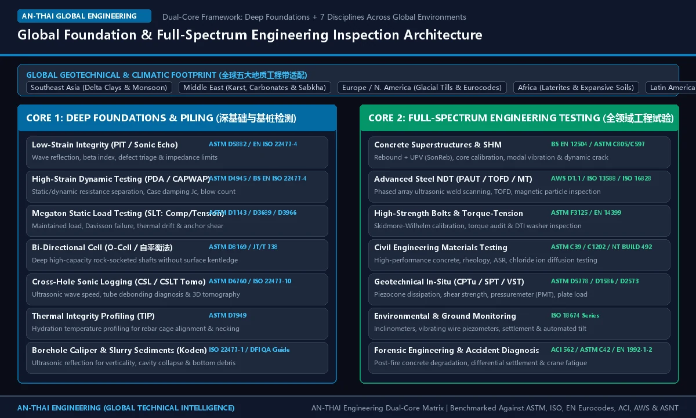
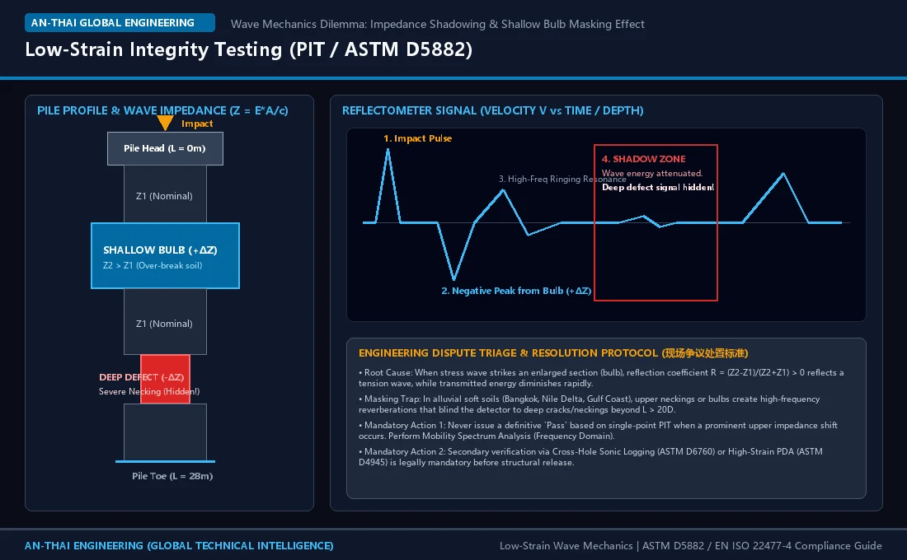
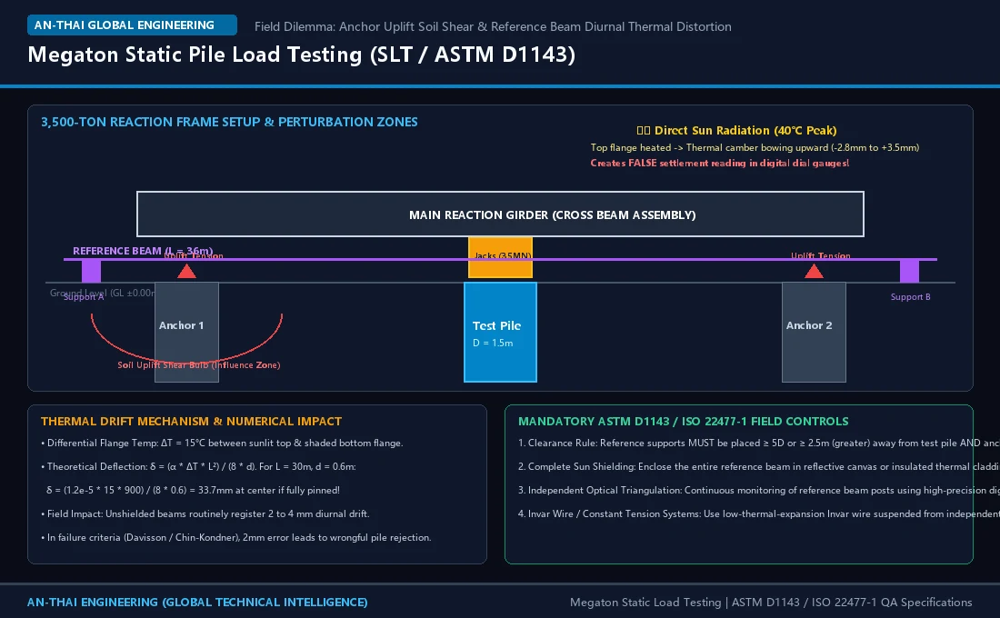
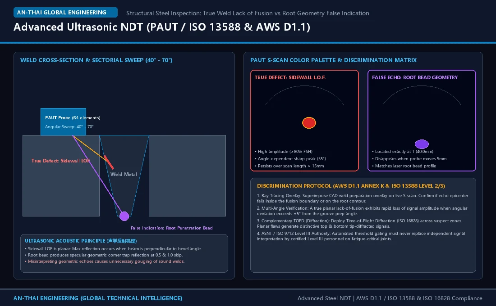
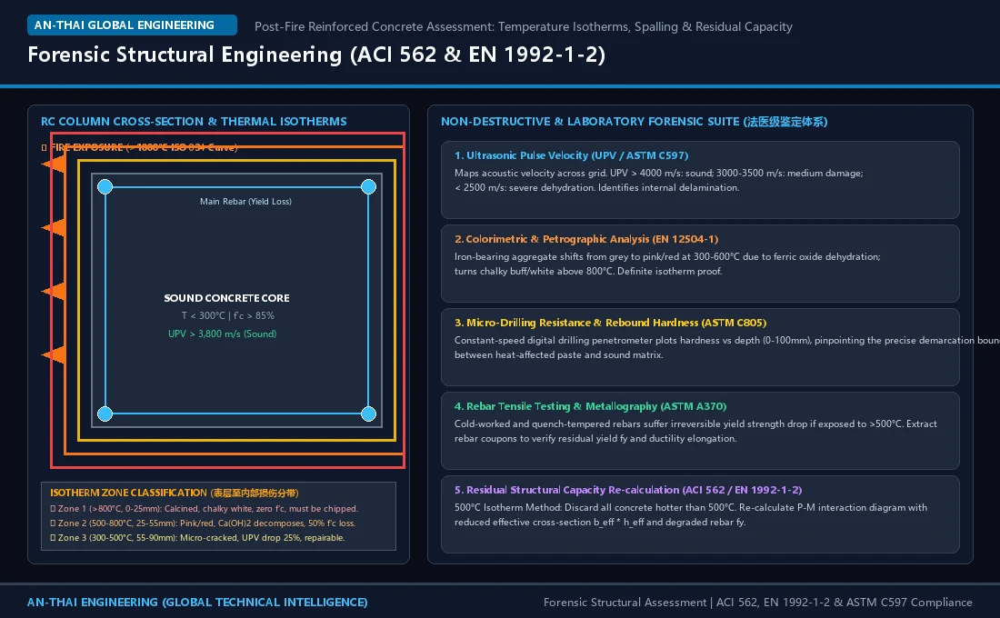
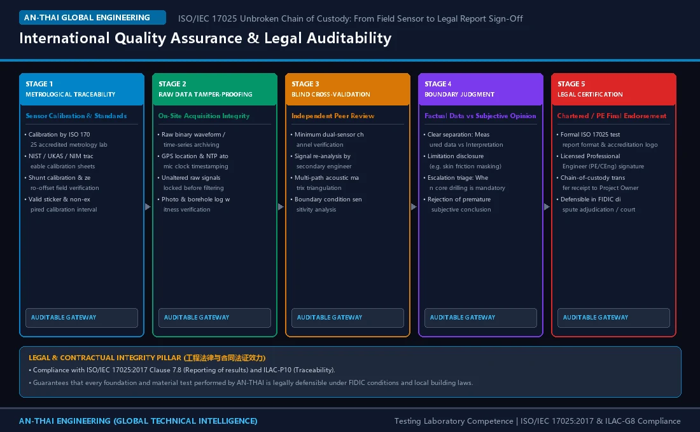

# An-Thai 全球桩基工程与全领域工程检测实战洞察
## Global Foundation & Full-Spectrum Engineering Inspection: Technical Field Manual & Global Practice Guide

> **Document ID:** ANTHAI-ENG-MANUAL-20261118-01  
> **Classification:** Engineering Operational Standard / B2B Technical Intelligence  
> **Author & Technical Entity:** AN-THAI Engineering Company Limited (Technical QA & Inspection Division)  
> **Global Geological Coverage:** Southeast Asia (Alluvial/Marine Clay), Middle East (Carbonate/Karst/Sabkha), Europe & North America (Glacial Tills/Overconsolidated Clays), Africa (Laterites/Expansive Black Cotton Soils), Latin America (Seismic Alluvium/Volcanic Ash)  
> **Accreditation & Quality Benchmark:** ISO/IEC 17025:2017 Competence of Testing and Calibration Laboratories | ILAC-G8 Decision Rules  
> **Status:** Published Technical Guide (Candidate Branch: `t3/global-engineering-insights`, Under Review)

---

## Executive Summary & Strategic Positioning (宏观战略与全球化视野)

Modern infrastructure megaprojects—spanning deep-water ports, high-speed rail viaducts, supertall commercial towers, LNG export terminals, and industrial processing complexes—operate under extreme geotechnical uncertainties and tight contractual tolerances. Historically, testing operations were compartmentalized by regional borders and fragmented testing scopes.

**AN-THAI Engineering** breaks through geographic and operational boundaries by implementing a **Dual-Core Architecture (双核驱动架构)**:
1. **Core 1: Deep Foundations & Geotechnical Engineering (深耕桩基与深基础工程)** — End-to-end foundation diagnostics from borehole drilling caliper logging to megaton static proof testing.
2. **Core 2: Full-Spectrum Engineering Testing & Forensic Quality Assessment (纵贯全领域工程试验检测与法医鉴定)** — Covering superstructures, structural steel advanced NDT, construction materials science, in-situ geotechnical geotechnics, automated geotechnical/environmental monitoring, and structural failure forensic investigations.

*Figure 1: AN-THAI Engineering Global Dual-Core Architecture mapping 7 key engineering disciplines across five major global geotechnical zones under international standards.*

---

## 1. Global Geotechnical & Environmental Alignment (全球五大地质工程带技术适配)

A testing methodology valid in dense European glacial gravels will fail or yield invalid data if blindly applied to soft tropical marine clay or Middle Eastern karst formations. AN-THAI structures testing protocols specifically around regional soil-structure interaction regimes:

| Global Geotechnical Zone | Predominant Geological Formations | Dominant Engineering Risks & Testing Traps | Core International Testing Protocols |
| :--- | :--- | :--- | :--- |
| **Southeast Asia (东南亚冲积三角洲)** | Chao Phraya / Mekong Delta soft marine clay ($S_u < 20\text{ kPa}$), high groundwater table, dense sand aquifers | High negative skin friction, shaft necking, CSL tube debonding from hydration heat, lateral pile deflection | ASTM D6760 (CSL), ASTM D5882 (PIT), ASTM D1143 (SLT), CPTu pore dissipation |
| **Middle East & Gulf (中东碳酸盐与盐渍土)** | Coralline limestone, karst cavities, gypiferous sand, highly saline sabkha groundwater ($\text{Cl}^- > 30,000\text{ mg/L}$) | Cavity collapse during drilling, high sulfate/chloride degradation of pile shafts, erratic end-bearing capacity | Koden ultrasonic caliper, O-Cell (ASTM D8169), ASTM C1202 chloride diffusion, TIP (ASTM D7949) |
| **Europe & North America (欧美冰川沉积与硬土)** | Overconsolidated London Clay, glacial till, dense boulder clays, hard bedrock sockets | High toe damping in dynamic tests, anchor pile uplift failure in heavy SLT, brittle rock socket micro-fissures | BS EN ISO 22477 series, BS EN 12504, ASTM D4945 (PDA/CAPWAP), TOFD weld inspection |
| **Africa (非洲红粘土与膨胀土)** | Ferruginous laterites, collapsible sands, expansive black cotton clays (smectite/montmorillonite) | Wetting collapse, severe seasonal moisture heave, pile shaft tension cracks from expansive soil swelling | Field Plate Load Test (ASTM D1194), VST (ASTM D2573), Inclinometer & Piezometer array (ISO 18674) |
| **Latin America (拉美地震带与火山灰沉积)** | Highly compressible volcanic ash soils (Andosols), high-seismicity subduction alluvium | Dynamic soil liquefaction, degradation of lateral pile stiffness ($p-y$ curves), seismic residual capacity | Cyclic lateral pile load test (ASTM D3966), Cross-hole seismic downhole testing, Dynamic SHM modal testing |

---

## 2. Seven Full-Spectrum Engineering Inspection Disciplines (全品类工程检测与试验覆盖域)

### 2.1 Discipline I: Deep Foundation & Pile Integrity Testing (基桩与地下基础检测)
- **Low-Strain Impact Integrity Testing (PIT / Sonic Echo / Impulse Response)**: Conforming to **ASTM D5882** and **EN ISO 22477-4**. Evaluates pile shaft continuity, identifies major voids, necking, cracks, and soil inclusions down to depth limits ($L/D \le 25\sim 30$).
- **High-Strain Dynamic Pile Testing (PDA / CAPWAP)**: Conforming to **ASTM D4945**. Employs heavy drop hammers ($1.5\%\sim 2.5\%$ of target ultimate capacity) equipped with strain transducers and piezoresistive accelerometers to compute mobilized capacity, shaft skin friction, and end bearing via rigorous wave-equation signal matching.
- **Static Load Testing (SLT: Compression, Tension, Lateral)**: Conforming to **ASTM D1143 / D1143M** (Axial Compressive), **ASTM D3689** (Axial Tensile Uplift), and **ASTM D3966** (Lateral Load). The gold standard for ultimate load capacity and load-settlement ($Q-s$) performance evaluation.
- **Bi-Directional Static Load Testing (O-Cell / 自平衡法)**: Conforming to **ASTM D8169 / D8169M** and **JT/T 738**. Hydraulically sacrificial load cells cast into the pile shaft near the balance point, testing upper skin friction against lower shaft resistance and end bearing simultaneously without ground-surface reaction kentledge.
- **Cross-Hole Sonic Logging (CSL / CSLT 3D Tomography)**: Conforming to **ASTM D6760**. Employs multi-tube ultrasonic transmitter/receiver pairs (40–60 kHz) to scan concrete quality across intersecting chords, combined with tomographic wave-speed inversion.
- **Thermal Integrity Profiling (TIP)**: Conforming to **ASTM D7949**. Measures cement hydration heat dissipation across embedded thermal sensor wires or thermal probes, identifying cage eccentricity, necking, and cover thickness during early curing (12–48 hours).
- **Borehole Wall Caliper & Sediments Profiling (Koden / Sonic Caliper)**: Measures slurry-supported drilled shaft diameter, verticality inclination, cave-ins, and bottom sediment thickness prior to rebar lowering.

### 2.2 Discipline II: Superstructures & Structural Concrete Testing (主体结构与建构筑物检测)
- **Non-Destructive & Semi-Destructive Strength Evaluation**: Ultrasonic Pulse Velocity (UPV, **ASTM C597**) combined with Rebound Hammer (**ASTM C805 / BS EN 12504-2**) using the **SonReb method**, mathematically calibrated against core compression (**ASTM C42 / BS EN 12504-1**).
- **Reinforcement Scanning & Cover Depth Measurement**: High-frequency electromagnetic pulse induction and ground-penetrating radar (GPR) conforming to **BS 1881-204** to map rebar location, spacing, diameter, and concrete cover depth.
- **Carbonation & Chemical Ingress Profiling**: Phenolphthalein indicator spray tests on freshly broken surfaces (**BS EN 14630**) to determine depth of carbonation and depassivation of internal rebar.
- **Load-Deflection Proof Testing of Slabs & Bridges**: Controlled static proof loading using calibrated water tanks or hydraulic rigs, paired with digital linear variable differential transformers (LVDTs) and fiber-optic strain arrays to confirm serviceability limits (**ACI 318 / EN 1992**).
- **Structural Health Monitoring (SHM) & Operational Modal Analysis (OMA)**: Multi-channel triaxial accelerometer arrays recording ambient vibration, natural frequencies, mode shapes, and damping ratios to identify structural stiffness degradation over time.

### 2.3 Discipline III: Steel Structures & Industrial Advanced NDT (钢结构与工业无损检测)
- **Phased Array Ultrasonic Testing (PAUT)**: Conforming to **ISO 13588** and **AWS D1.1 Annex K**. Employs 64-element or 128-element linear probes to produce dynamic electronic sectorial and linear scans ($S\text{-scans}$ and $E\text{-scans}$), achieving full volumetric coverage of complex full-penetration groove welds.
- **Time-of-Flight Diffraction (TOFD)**: Conforming to **ISO 16828**. Uses tip-diffracted ultrasonic energy from upper and lower flaw edges to measure flaw height and through-wall sizing accurately, independent of amplitude attenuation.
- **Conventional NDT**: Magnetic Particle Testing (MT, **ASTM E709 / ISO 9934**), Liquid Penetrant Testing (PT, **ASTM E165 / ISO 3452**), Radiographic Testing (RT, **ISO 17636**), and Eddy Current Testing (ET, **ISO 15549**).
- **High-Strength Bolting QA**: Calibrated wrench torque audits, Skidmore-Wilhelm bolt tension calibrators, Direct Tension Indicator (DTI) washer gap verification, and ultrasonic bolt stress measurement (**ASTM F3125 / EN 14399**).
- **Corrosion Protection & Coating Audits**: Dry Film Thickness (DFT) electromagnetic/eddy current measurement (**SSPC-PA 2 / ISO 2808**) and cross-hatch / hydraulic dolly pull-off adhesion testing (**ASTM D4541 / ISO 4624**).

### 2.4 Discipline IV: Civil Engineering Materials Laboratory & Site Testing (土木工程材料试验)
- **Cementitious Systems & Supplementary Materials**: Standard consistency, initial/final setting time (**ASTM C191**), Blaine air permeability fineness (**ASTM C204**), and 3d/7d/28d mortar prism compressive and flexural strength (**ASTM C109 / EN 196-1**).
- **Aggregate Quality & Geometrical Grading**: Sieve gradation analysis, Flakiness and Elongation Index (**BS EN 933-3**), Los Angeles abrasion resistance (**ASTM C131**), and Aggregate Crushing Value (ACV, **BS 812-110**).
- **Fresh Concrete Rheology**: Slump test (**ASTM C143**), inverted slump cone, V-funnel and L-box flow testing for Self-Consolidating Concrete (SCC, **ASTM C1611 / C1621**), air content by pressure method (**ASTM C231**), and bleeding rate.
- **Hardened Concrete Durability & Transport Properties**: Rapid Chloride Permeability Test (RCPT, **ASTM C1202**), Non-Steady-State Chloride Migration (**NT BUILD 492**), Water Penetration under Pressure (**DIN 1048-5 / BS EN 12390-8**), and Freeze-Thaw Resistance (**ASTM C666**).
- **Steel Reinforcement & Mechanical Couplers**: Tensile yield, ultimate strength, elongation, and cold bend testing (**ASTM A370 / ISO 15630-1**); cyclic slip and fatigue testing of mechanical bar splices (**ISO 15835**).

### 2.5 Discipline V: Geotechnical Site Investigation & In-Situ Field Testing (岩土工程勘察与现场原位测试)
- **Piezocone Penetration Testing (CPT / CPTu)**: Conforming to **ASTM D5778** and **ISO 22476-1**. Digital continuous recording of cone tip resistance ($q_c$), sleeve friction ($f_s$), and dynamic pore pressure ($u_2$). Pore pressure dissipation tests ($t_{50}$) for in-situ coefficient of consolidation ($c_h$) and horizontal hydraulic conductivity.
- **Standard Penetration Testing (SPT)**: Conforming to **ASTM D1586**, energy-calibrated with direct load cell instrumented rods to establish normalized energy ratios ($N_{60}$).
- **Field Vane Shear Testing (VST)**: Conforming to **ASTM D2573**. Measures undrained peak and remolded shear strength ($S_u$ and $S_{ur}$) in sensitive clays, yielding true sensitivity ($S_t$).
- **Pressuremeter Testing (PMT)**: Conforming to **ASTM D4719 / ISO 22476-4**. Cylindrical radial expansion in pre-drilled boreholes to determine Menard modulus ($E_M$), creep pressure ($p_f$), and limit pressure ($p_L$).
- **Plate Load Testing (PLT)**: Conforming to **ASTM D1194 / BS 1377-9**. Rigid circular or square plate loading to compute the modulus of subgrade reaction ($k_s$) for mat foundations and road subgrades.

### 2.6 Discipline VI: Construction & Environmental Geotechnical Monitoring (工程施工与环境岩土监测)
- **Deep Lateral Displacement Monitoring (Borehole Inclinometers)**: Digitally controlled biaxial servo-accelerometer probes running in grooved ABS casing to measure sub-millimeter horizontal deflections of diaphragm walls, sheet piles, and slope shear planes (**ISO 18674-3**).
- **Piezometric Groundwater Pressure Tracking**: High-precision vibrating-wire piezometers (VWP) installed in isolated bentonite-cement grout seals to monitor transient pore water heads and aquifer drawdowns (**ISO 18674-4**).
- **Precise Geodetic Settlement & Tilt**: Sub-millimeter digital invar-staff optical levelling, liquid-level settlement gauges, and biaxial automated electrolytic tiltmeters on surrounding buildings and sensitive infrastructure.
- **Structural Anchor & Strut Load Cells**: Hollow-plunger vibrating wire or hydraulic load cells tracking real-time prestress retention and load transfer on ground anchors and steel bracing struts (**ISO 18674-5**).

### 2.7 Discipline VII: Forensic Structural Engineering & Quality Accident Diagnosis (工程质量事故诊断与法医鉴定)
- **Differential Settlement & Structural Distress Investigation**: Mapping building angular distortion ($\beta > 1/500$), tilt angles, crack propagation kinematics, and soil-structure redistribution analysis.
- **Post-Fire Structural Concrete Assessment**: Determining thermal isotherm penetration, microstructural decomposition of calcium silicate hydrate (C-S-H), rebar annealing, and residual load capacity in accordance with **ACI 562** and **EN 1992-1-2**.
- **Alkali-Silica Reaction (ASR) & Delayed Ettringite Formation (DEF)**: Petrographic thin-section examination under polarized light microscopy (**ASTM C856**), uranyl acetate fluorescence, and residual expansion testing (**ASTM C1260 / C1293**).
- **Industrial Crane Runway & Steel Fatigue Failure**: In-situ magnetic particle crack sizing, strain-gauge cycle counting, stress range ($\Delta\sigma$) calculation, and fracture mechanics fatigue life evaluation under **BS 7608 / IIW recommendations**.

---

## 3. Deep-Dive: Real Engineering Controversies & Forensic Resolution Paths (真实痛点、现场争议与疑难杂症深挖)

### 3.1 Dispute 1: Low-Strain (PIT) Impedance Shadowing & Defect Masking
**The Jobsite Dilemma:**  
On deep bored pile and driven cast-in-place installations, contractors frequently rely on low-strain PIT as an inexpensive, rapid clearance tool. However, when an upper section experiences an enlargement or "bulb" (due to soil over-break or casing withdrawal delays), the wave impedance increases:
$$Z_2 = \frac{E \cdot A_2}{c} > Z_1 = \frac{E \cdot A_1}{c}$$
At this interface, the reflection coefficient:
$$R = \frac{Z_2 - Z_1}{Z_2 + Z_1} > 0$$
generates a strong negative velocity reflection (downward trough in typical display conventions). The transmitted stress wave suffers significant attenuation. When this attenuated wave encounters a deeper, severe defect (e.g., necking or soil inclusion at $L/D > 15$), the returning tension reflection is so weak that it is completely obscured by the high-frequency reverberations and surface surface-wave ringing of the upper bulb. Reports routinely misclassify such compromised piles as "sound with minor bulb."

*Figure 2: Wave mechanics of low-strain integrity testing showing how a shallow impedance increase (+ΔZ) creates a severe shadow zone, masking deep structural necking.*

**The AN-THAI Engineering Resolution Protocol:**
1. **Mobility Spectrum Analysis (Frequency Domain)**: Never rely exclusively on time-domain velocity traces. Compute mechanical admittance (Mobility $N = \frac{v}{F}$). A shallow bulb exhibits characteristic high-frequency resonant peaks; if the mobility baseline drops below theoretical values ($N_0 = \frac{1}{\rho c A}$), wave energy penetration to the toe is physically impossible.
2. **Mandatory Depth-to-Diameter Threshold ($L/D$)**: Enforce **ASTM D5882 §6.3.2**; whenever $L/D > 20$ in stiff or layered soils, PIT cannot guarantee toe verification.
3. **Secondary Non-Destructive Escalation**: If an upper impedance jump exceeding $R > 0.20$ is observed, mandatory cross-verification via **Cross-Hole Sonic Logging (ASTM D6760)** or **High-Strain PDA (ASTM D4945)** must be contractually triggered before capping and structural sign-off.

---

### 3.2 Dispute 2: Megaton Static Load Test (SLT) Anchor Uplift Shear & Thermal Beam Bowing
**The Jobsite Dilemma:**  
Static load tests on high-capacity piles ($Q_{ult} \ge 25\text{ MN}$ to $40\text{ MN}$) require massive reaction systems. Two widespread sources of field measurement distortion corrupt load-displacement ($Q-s$) records:
1. **Anchor Pile Uplift Shear Bulb**: As reaction anchor piles are pulled upward under extreme tensile loads (often 8–12 MN total uplift), the surrounding soil undergoes upward shear deformation. If reference beam supports are placed too close to the reaction anchor piles ($< 4D$), the supports heave upward along with the ground. This makes the test pile appear to experience excessive settlement or, conversely, causes apparent rebound during maintained load holds!
2. **Diurnal Solar Thermal Bowing**: Steel reference beams measuring 24 m to 36 m in length are exposed to direct sunlight. A top-to-bottom flange temperature difference ($\Delta T$) of just 15°C causes significant thermal bowing:
$$\delta_{\text{thermal}} = \frac{\alpha \cdot \Delta T \cdot L^2}{8 \cdot d}$$
For a beam of $L = 30\text{ m}$ and depth $d = 0.6\text{ m}$, with structural steel coefficient $\alpha = 1.2 \times 10^{-5}\text{ /°C}$, the unconstrained center deflection exceeds 2.5 mm to 4.0 mm throughout the day—an error large enough to falsely fail a pile evaluated under the **Davisson Criterion**:
$$s_{\text{fail}} = \frac{Q L}{A E} + 0.15\text{ in} + \frac{D}{120}$$

*Figure 3: Reaction setup for megaton static load testing, detailing anchor pile upward soil shear zones and diurnal thermal radiation distortion of the reference beam.*

**The AN-THAI Engineering Resolution Protocol:**
1. **Geometric Separation Rule**: Strictly enforce **ASTM D1143 §6.3**: Reference beam supports must be located at a clear distance of at least $5D$ from the test pile, and at least $2.5\text{ m}$ from any reaction pile or kentledge cribbing.
2. **Total Thermal Encapsulation**: Wrap the entire reference beam in continuous reflective insulated cladding, or erect a covered thermal tent over the test area. Install calibrated surface thermocouples to track beam temperature.
3. **Independent Precision Optical Geodesy**: Install electronic invar precision digital levels outside the site's zone of influence ($> 30\text{ m}$ away), reading barcoded invar scales fixed to the test pile head and reference supports every 15 minutes to eliminate thermal drift algebraically.

---

### 3.3 Dispute 3: CSL Acoustic Tube Debonding vs True Concrete Honeycombing
**The Jobsite Dilemma:**  
Cross-Hole Sonic Logging (CSL) frequently exhibits severe First Arrival Time (FAT) delays ($> 20\%$) and energy dropoffs ($> 20\text{ dB}$). Piling subcontractors and consultants frequently enter fierce legal disputes: does this represent honeycombing, mud cake, or merely micro-detachment of the steel access tube from concrete due to differential thermal contraction?

**The AN-THAI Multi-Path Matrix Resolution:**
In a 4-tube pile shaft (6 testing chords: 4 perimeter, 2 diagonal):
- **Tube Debonding Signature:** If Tube #2 has debonded, signals across Path 1-2, Path 2-3, and Diagonal 2-4 will all show severe FAT delays. However, Path 3-4, Path 4-1, and Diagonal 1-3 (all completely independent of Tube #2) will show pristine wave speed ($v > 3,800\text{ m/s}$) and clean energy transmission at that exact same elevation.
- **Genuine Concrete Defect Signature:** A real physical defect (void, soil pocket) intersecting the central core will delay intersecting paths (e.g., both Diagonal 1-3 and 2-4, or multiple perimeter paths) regardless of tube identity.

---

### 3.4 Dispute 4: Advanced Steel NDT — PAUT Sidewall LOF vs Geometric Root Misalignment
**The Jobsite Dilemma:**  
During phased array ultrasonic testing (PAUT) of thick full-penetration butt welds (e.g., heavy column-to-baseplate joints or offshore tubular nodes under **AWS D1.1**), high-amplitude indications often appear in the root area. Untrained inspectors frequently reject the weld as "Sidewall Lack of Fusion (LOF)," demanding destructive gouging and repair, which induces residual stress and heat-affected zone (HAZ) embrittlement. In reality, internal weld hi-lo mismatch and root reinforcement beads create acoustic corner-trap specular reflections that mimic planar defects.

*Figure 4: Phased Array Ultrasonic Testing (PAUT) sectorial sweep (40°–70°) showing discrimination between true planar sidewall lack of fusion and benign geometric root reflections.*

**The AN-THAI Engineering Resolution Protocol:**
1. **Ray-Tracing CAD Groove Overlay**: Conforming to **ISO 13588 Level 2/3**, overlay the precise as-built groove geometry onto the live sectorial scan ($S\text{-scan}$). True sidewall LOF aligns strictly along the bevel slope angle.
2. **Angular Sensitivity Characterization**: Planar lack of fusion reflects specularly; rotating the focal beam by $\pm 5^\circ$ causes a dramatic amplitude drop ($> 12\text{ dB}$). By contrast, a rounded root bead reflects diffusely across a broad angular spectrum ($45^\circ\sim 70^\circ$).
3. **Independent TOFD Verification**: Conforming to **ISO 16828**, deploy dual-probe Time-of-Flight Diffraction across the joint. If no diffraction tip signals appear at the suspect depth, the indication is non-planar geometric artifact.

---

### 3.5 Dispute 5: Forensic Assessment of Fire-Damaged Concrete Structures
**The Jobsite Dilemma:**  
Following an industrial fire in a reinforced concrete warehouse, building owners and insurers face a multi-million-dollar decision: complete demolition or structural rehabilitation? Visual surface inspection is dangerously misleading—spalled, black soot-covered concrete may possess a sound core, while visually intact columns may have suffered irreversible internal paste dehydration and rebar annealing.

*Figure 5: Post-fire reinforced concrete column forensic isotherms, microstructural degradation phases, and multi-method non-destructive testing verification matrix.*

**The AN-THAI Multi-Tier Forensic Protocol:**
1. **The 500°C Isotherm Method (EN 1992-1-2 / ACI 562)**: Concrete exposed to temperatures exceeding $500^\circ\text{C}$ loses $> 50\%$ of its compressive strength and undergoes irreversible calcium hydroxide decomposition:
$$\text{Ca(OH)}_2 \xrightarrow{450^\circ\text{C}\sim 500^\circ\text{C}} \text{CaO} + \text{H}_2\text{O}\uparrow$$
All concrete within the $500^\circ\text{C}$ isotherm envelope must be mechanically removed (hydro-demolition or chipping) down to sound matrix.
2. **Colorimetric Isotherm Mapping**: Siliceous aggregate changes color predictably:
   - Ambient to $300^\circ\text{C}$: Normal grey.
   - $300^\circ\text{C}$ to $600^\circ\text{C}$: Pink to reddish (iron oxide oxidation).
   - $600^\circ\text{C}$ to $900^\circ\text{C}$: Whitish-grey / buff.
   - $> 900^\circ\text{C}$: Yellowish-brown (sintering).
3. **Core Extraction & Ultrasonic Tomography (ASTM C597 & C42)**: Extract small-diameter cores at calibrated depths. Plot residual elastic modulus ($E_c$) and UPV gradients to mathematically define the effective un-damaged section ($b_{\text{eff}} \times h_{\text{eff}}$) for structural P-M capacity re-calculation.

---

## 4. Authoritative International Standards Matrix (国际规范权威对标体系)

Every testing method implemented by AN-THAI is executed under strict international standard references, ensuring total contractual validity across global engineering jurisdictions:

| Testing Domain | Core ASTM Standard | ISO / EN Standard | Industry Specialized Standard | Mandatory Field Quality Acceptance Criterion |
| :--- | :--- | :--- | :--- | :--- |
| **Low-Strain Integrity** | ASTM D5882 | BS EN ISO 22477-4 | AFNOR NF P94-160-2 | Clear toe reflection verified, beta index $\beta \ge 0.80$, no anomalous early reflections |
| **High-Strain PDA** | ASTM D4945 | EN ISO 22477-4 | ISSMGE Dynamic Guide | Signal match quality number $MQN < 3.0$ in CAPWAP; energy transfer $ETR > 30\%$ |
| **Static Load Testing** | ASTM D1143 / D3689 | ISO 22477-1 / EN 1997 | ICE S specification | Settlement rate $< 0.25\text{ mm/hr}$ at maintained load hold; Davisson failure check |
| **Bi-Directional O-Cell**| ASTM D8169 | ISO 22477-1 | JT/T 738-2008 | Equivalent top-load conversion curve via elastic modulus integration; cell closure check |
| **Sonic Logging (CSL)** | ASTM D6760 | ISO 22477-10 | DFI CSL Guide | First Arrival Time increase $\Delta\text{FAT} \le 10\%$, energy reduction $\le 6\text{ dB}$ (Sound) |
| **Thermal Profiling (TIP)**| ASTM D7949 | — | DFI TIP Guide | Effective cage cover radius variation $< 10\%$; hydration temperature symmetry |
| **Concrete Compressive** | ASTM C39 / C42 | BS EN 12390-3 / 12504-1 | ACI 318 / ACI 214R | Core length-to-diameter ratio $L/D$ correction ($1.00\le L/D\le 2.00$); end planeness |
| **UPV & Rebound (SonReb)**| ASTM C597 / C805 | BS EN 12504-2 & 12504-4 | RILEM NDT 1 | Dual-parameter regression correlation with project-specific drilled core compressive samples |
| **PAUT Weld Testing** | ASTM E2700 | ISO 13588 / ISO 9712 | AWS D1.1 / D1.1M Annex K | Level III approved scan plan; DAC/TCG calibration curve; evaluation threshold $\ge 20\%\text{ FSH}$ |
| **TOFD Flaw Sizing** | ASTM E2373 | ISO 16828 | ASME Sec V Art 4 | Lateral wave and backwall signal resolution; dead-zone compensation |
| **High-Strength Bolts** | ASTM F3125 | BS EN 14399 | AISC 360 / RCSC Spec | Minimum pretension $\ge 1.05 \times$ specified design clamping force; DTI gap audit |
| **Chloride Permeability**| ASTM C1202 | NT BUILD 492 | AASHTO T277 | Total charge passed ($< 1,000\text{ Coulombs}$ for high-performance durability concrete) |
| **Piezocone CPTu** | ASTM D5778 | ISO 22476-1 | ISSMGE TC16 Guide | Cone zero-load baseline check before/after push; dynamic pore dissipation curve fit |
| **Borehole Inclinometer**| ASTM D6230 | ISO 18674-3 | CIRIA C760 | Dual-pass spiral error correction ($A+ / A-$ tracking); systematic zero shift removal |
| **Forensic Fire Assess** | ASTM C856 / C597 | EN 1992-1-2 / EN 12504-1 | ACI 562 / Concrete Soc TR68 | $500^\circ\text{C}$ isotherm demarcation; rebar residual yield testing ($f_y$ reduction curve) |

---

## 5. ISO/IEC 17025 Quality Assurance & Forensic Traceability (实验室体系与法律效力链路)

Every engineering inspection report generated by AN-THAI is built to withstand rigorous forensic scrutiny in legal, insurance, and FIDIC contractual arbitrations:

*Figure 6: Unbroken 5-stage ISO/IEC 17025 quality assurance chain from accredited sensor calibration to licensed engineer sign-off and legal auditability.*

1. **Metrological Sensor Calibration**: All hydraulic pressure transducers, electronic load cells, piezoresistive accelerometers, and LVDTs undergo annual calibration in ISO/IEC 17025 accredited metrological facilities with full NIST/UKAS/NIM traceability. Field shunt calibrations and zero baselines are recorded before and after every single test.
2. **Tamper-Evident Raw Data Preservation**: Field acquisition devices capture raw, unmanipulated binary files (e.g., `.wfl` for PIT, `.pda` for dynamic testing, `.csl` for sonic logging, `.dat` for PAUT). These raw binaries are timestamped with satellite GPS coordinates and cryptographic hashes, preventing post-acquisition smoothing, filtering, or manual alteration.
3. **Strict Separation of Facts vs Engineering Judgment**: In compliance with **ISO/IEC 17025:2017 Clause 7.8**, AN-THAI reports maintain a strict demarcation between *Factual Measured Data* (recorded force/velocity waveforms, raw transit times, load-settlement gauges) and *Interpretive Engineering Analysis* (beta factor estimations, capacity calculations, acceptance recommendations).
4. **Professional Sign-Off Authority**: Every final inspection dossier is independently reviewed by an authorized Level III NDT Specialist / Registered Professional Engineer (PE / Chartered Engineer CEng) holding valid statutory certifications.

---

## 6. Actionable Enquiry Guidance & Project Scope Submission (标准化工程咨询与技术接洽指南)

When submitting deep foundation or engineering testing requirements to AN-THAI Engineering, project teams and owners should provide the following critical technical dossiers to receive an exact, optimized testing proposal:

1. **For Foundation Testing (PIT / PDA / SLT / CSL / O-Cell):**
   - Foundation layout drawings, pile schedules (diameter, cut-off level, toe elevation, design working load $Q_w$).
   - Geological investigation report (soil borehole logs, SPT-$N$ profiles, groundwater table, bedrock socket depth).
   - Project specifications citing target international standards (e.g., ASTM D1143, ASTM D4945, ASTM D6760) and required testing percentages.
   - Site access constraints (overhead headroom for drop hammer rigs, working platform load-bearing capacity).
2. **For Superstructures, Steel NDT & Forensic Assessments:**
   - Structural design drawings, weld joint geometry details, steel grade, and design stress classifications.
   - Historical records (concrete mix design, batching plant delivery tickets, pour dates, temperature monitoring logs).
   - In forensic cases: incident timeline, photographic logs of distress/fire event, prior testing reports.

**Direct AN-THAI Engineering Consultation Routes:**
- **Online Engineering Enquiry Portal:** [https://an-thai.com/contact.html?type=engineering#enquiry-form](https://an-thai.com/contact.html?type=engineering#enquiry-form)
- **Primary Technical Email:** `anthaicheng@gmail.com` | **Domain Email:** `info@an-thai.com`
- **Official LINE Engineering Channel:** [LINE ID: rachada2018](https://line.me/ti/p/~rachada2018) (Direct engineering enquiries for Thailand and Southeast Asia; search ID `rachada2018` in the LINE app if the direct link does not open)

---
*AN-THAI Engineering Company Limited — Global Deep Foundations & Full-Spectrum Engineering Inspection Intelligence.*
